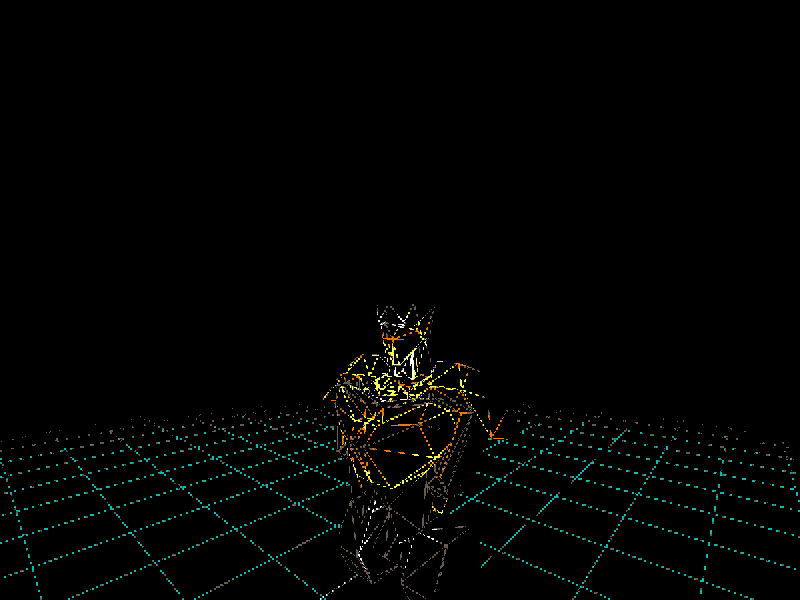
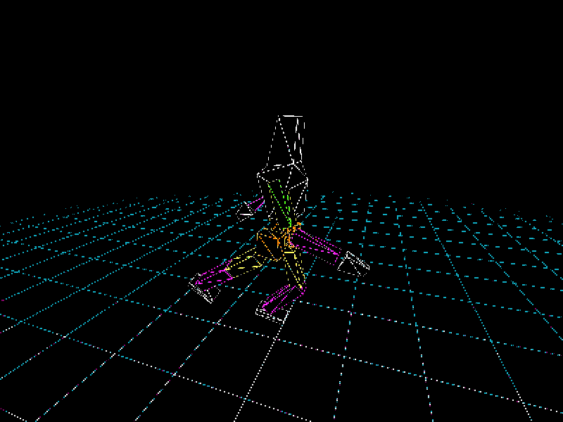
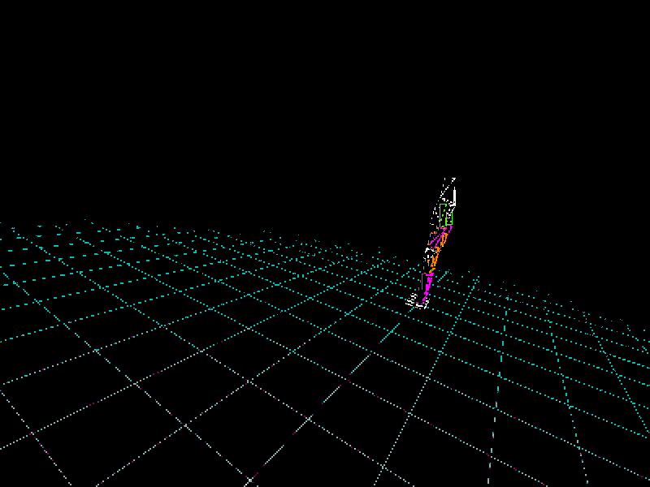

# Terminus, Vulkan Renderer/Game Engine
I wanted to make a first person shooter, but wasn't satisfied with how 3D game engines demanded you used their bespoke approach to managing a 3D environment. I felt learning just one game engine was counterproductive to my learning, as in the short term I would be wasting time wresting with UI and in the long term I'd be pigeonholed into a potentially restrictive or superseded set of tools. This led me to decide to learn the fundamentals of 3D and game engine programming, and I put that learning into practice through my game: [Terminus](https://github.com/NoXNote/PublicTerminus).

Terminus used the then standard, but now legacy, rendering method of Render Passes. This involved a severe amount of boilerplate code required to render even one triangle, so I spring-boarded my project off the back of [Brendan Galea](https://www.youtube.com/@BrendanGalea)'s fantastic [Vulkan Game Engine Tutorial series](https://www.youtube.com/playlist?list=PL8327DO66nu9qYVKLDmdLW_84-yE4auCR). I essentially followed it line by line up to where he started introducing specular lighting and texturing, at which point I felt confident enough to start building my own features. 

## Animation System

The most significant part feature implemented was my procedural pseudo-skeletal animation system. I did not need the versatility of fully fleshed skeletal rigs and hand made animations, which allowed me to define animations via mathematical functions. A humanoid's walk cycle is largely cyclical in nature, so I was able to map motions found in walking/running to the various trigonometric functions. For instance, the swinging of an arm is able to be represented by a rotation [modulated by a sin-wave](https://github.com/NoXNote/PublicTerminus/blob/7be432fa7488a52bbb5f260c82cce51765105949/shaders/enemy/enemy.vert#L122).

Humanoid entities use a [Super Shader](https://github.com/NoXNote/PublicTerminus/blob/7be432fa7488a52bbb5f260c82cce51765105949/shaders/enemy/enemy.vert#L122C5-L122C26) which defines behaviours per limb. Each limb calculates where it should be based on [contextual data](https://github.com/NoXNote/PublicTerminus/blob/7be432fa7488a52bbb5f260c82cce51765105949/shaders/enemy/enemy.vert#L6) (the humanoid's speed, changes in lean, and current animation progress). Each limb would be given an [ID](https://github.com/NoXNote/PublicTerminus/blob/7be432fa7488a52bbb5f260c82cce51765105949/shaders/enemy/enemy.vert#L21-L28), with the ID's negative counterpart representing the limb on the opposite side of the humanoid's body. The main function would choose how many transformations are required for each limb, such that the torso would have [less transformations](https://github.com/NoXNote/PublicTerminus/blob/7be432fa7488a52bbb5f260c82cce51765105949/shaders/enemy/enemy.vert#L227-L231) applied to it compared to the hand, which would require the application of [both the torso, and the upper/lower arm transformations](https://github.com/NoXNote/PublicTerminus/blob/7be432fa7488a52bbb5f260c82cce51765105949/shaders/enemy/enemy.vert#L187-L192). This is, in effect, [forward kinematics](https://en.wikipedia.org/wiki/Forward_kinematics).  I used Vulkan's [Specialisation Constants](https://docs.vulkan.org/samples/latest/samples/performance/specialization_constants/README.html), which allowed the compiler to optimise the shader on a per limb basis. This gave maintenance benefits of a single shader file without the runtime performance penalty of actual GPU branching.

*A Broken Humanoid Animation*

There was a large element of trial and error in getting the animations to feel natural. 

*Humanoid Turning in a Run*

I managed to get a pretty decent system in for managing turning. Sadly my path-finding solution doesn't show off this nuance of my animation shader.

*Humanoid Running Forward and Back*

The system seemed to respond really well to showing the change in motion when moving from walking to running. The animation isn't that good for low speeds, but a brisk walk and upwards seemed to look great.

## Pathfinding System

## Level Generation

## Terrain Deformation
