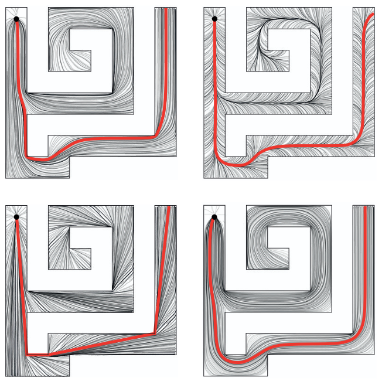
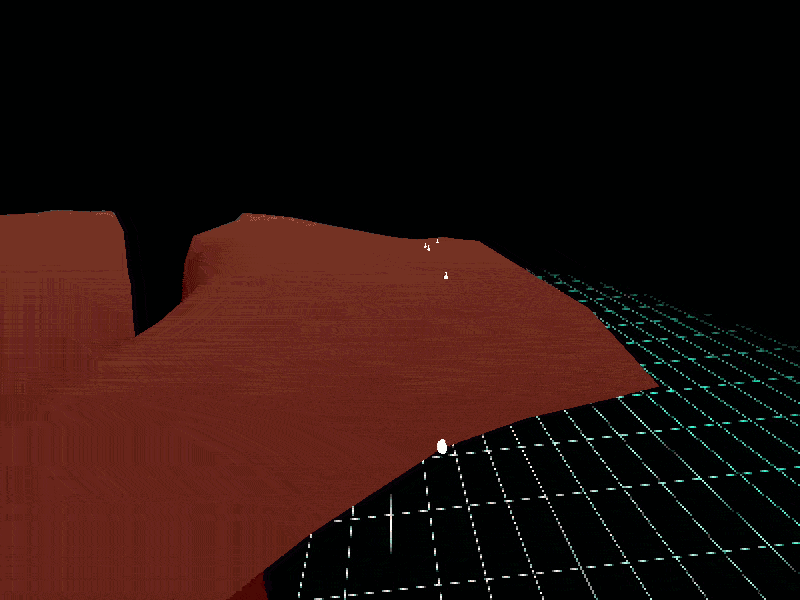
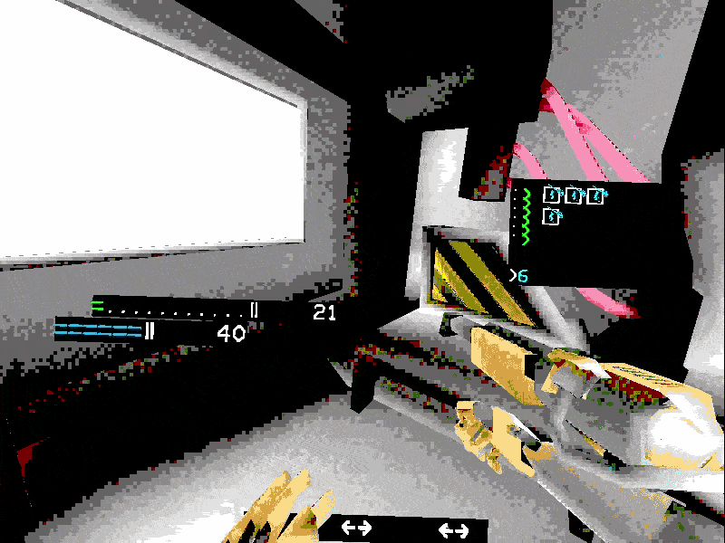
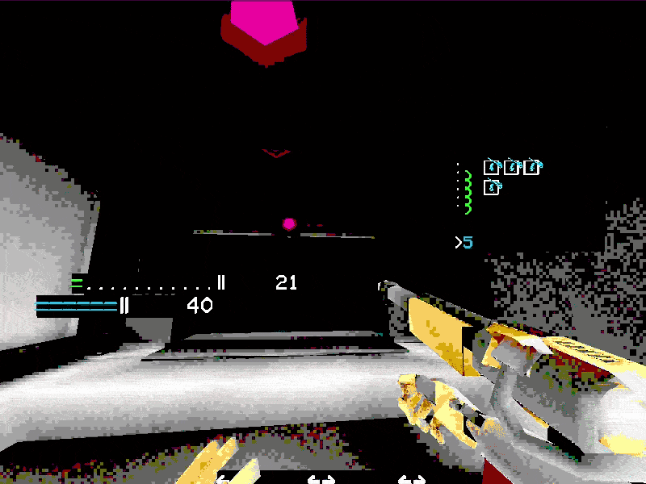
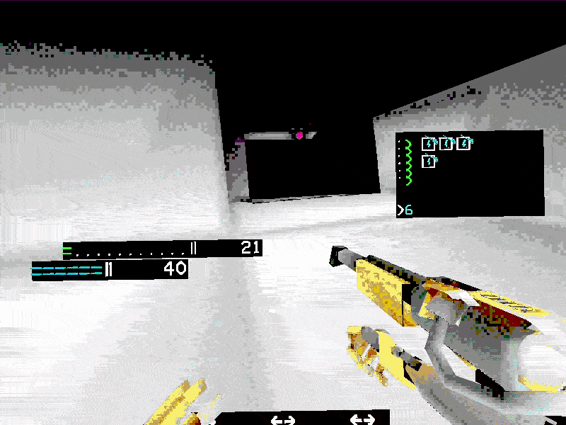
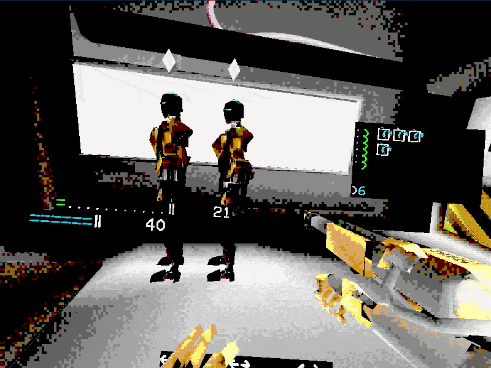
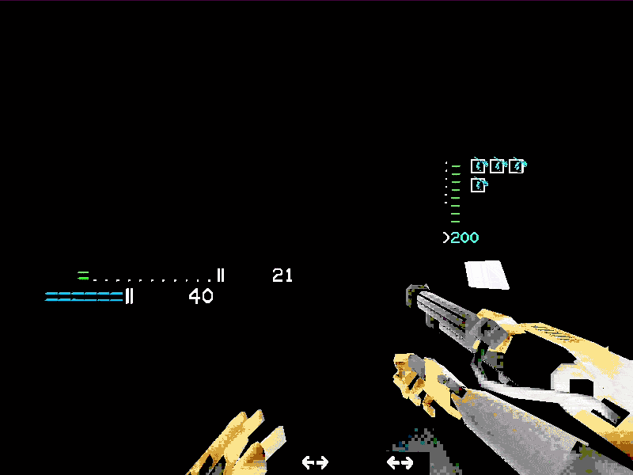
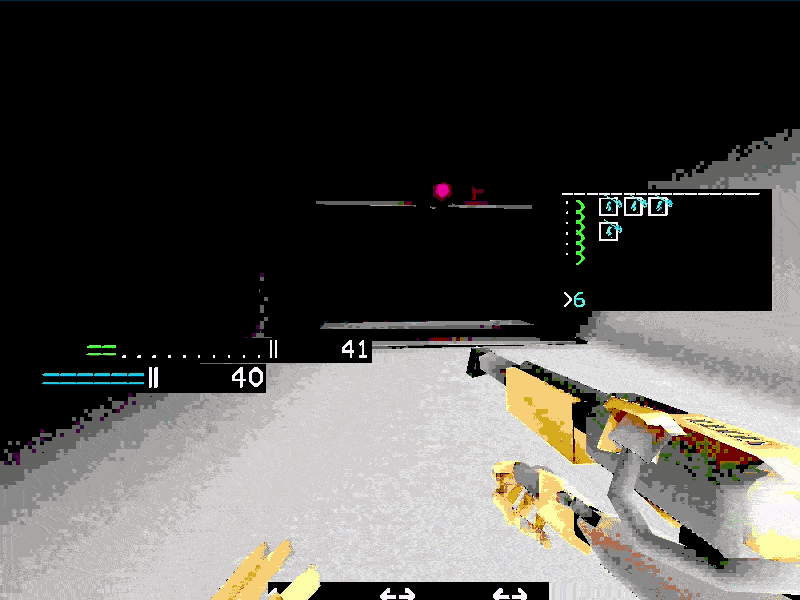
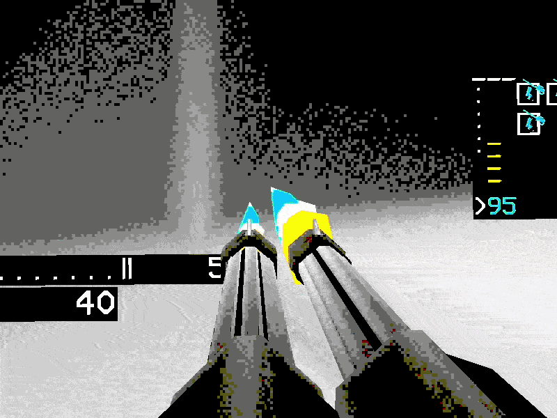

# Terminus, Vulkan Renderer/Game Engine
While my ultimate goal was to develop a first-person shooter, I became concerned that relying on a commercial 3D engine would force me into a specific workflow rather than teaching me the underlying principles. I felt that mastering a single engine's bespoke UI would be a short-term win at the expense of long-term technical depth. To avoid being pigeonholed into a restrictive set of tools, I chose to build a game engine from the ground up to master the fundamentals of 3D programming. This philosophy culminated in my project: [Terminus](https://github.com/NoXNote/PublicTerminus).

Now that I am comfortable with the fundamentals of 3D programming and the workings of game engines, I find that I now appreciate each of the quirks of Unity, Unreal, and Godot, rather than being blindly frustrated by them. With the knowledge I have now, I would have done many, many things differently. However, I still deeply value the time I had working to create something as ambitious as a game engine from a baseline of near zero knowledge.

## Table of Contents

- [Summary](#a-summary-of-what-i-made)
- [Rendering](#rendering)
- [Animation System](#animation-system)
- [Pathfinding System](#pathfinding-system)
- [Terrain Deformation](#terrain-deformation)
- [Level Generation](#level-generation)
- [ECS](#entity-component-system)
- [Collision System](#collision-system)
- [Gameplay](#gameplay)
- [Lessons Learned](#what-i-learned)

---

## A Summary of what I made
1.  A render system using the Vulkan API. OBJs with pre-baked lighting are loaded, and shaded using variable-rate shading frequency. Several pipelines are used for situations demanding different shading/vertex positioning.
2.  A game engine written from scratch in C++. I made all 3D assets, the physics/collision engine, the level generation algorithm, the GPU driven procedural animation system, the enemy AI, and the game serialisation/deserialisation system.

## Rendering

Terminus used the then standard, but now legacy, rendering method of **Render Passes** . This involved a significant amount of boilerplate code required to render even one triangle, so I leveraged [Brendan Galea](https://www.youtube.com/@BrendanGalea)'s fantastic [Vulkan Game Engine Tutorial series](https://www.youtube.com/playlist?list=PL8327DO66nu9qYVKLDmdLW_84-yE4auCR). I essentially followed it line by line up to where he started introducing specular lighting and texturing, at which point I felt confident enough to start building my own features. For the most part, each entity is managed by a system which includes all pipeline management and drawing logic.

## Animation System

The core of my animation system is a **procedural pseudo-skeletal approach**. By prioritizing mathematical functions over complex, hand-keyed skeletal rigs, I could define movements programmatically. Since a humanoid walk cycle is inherently periodic, I mapped locomotion motions to trigonometric functions—for example, representing the rhythmic swing of an arm as a rotation modulated by a sine wave [here](https://github.com/NoXNote/PublicTerminus/blob/7be432fa7488a52bbb5f260c82cce51765105949/shaders/enemy/enemy.vert#L122).

Humanoid entities use a [Super Shader](https://github.com/NoXNote/PublicTerminus/blob/7be432fa7488a52bbb5f260c82cce51765105949/shaders/enemy/enemy.vert#L122C5-L122C26) which defines behaviours per limb. Each limb calculates where it should be based on [contextual data](https://github.com/NoXNote/PublicTerminus/blob/7be432fa7488a52bbb5f260c82cce51765105949/shaders/enemy/enemy.vert#L6) (the humanoid's speed, changes in lean, and current animation progress). Each limb is assigned an [ID](https://github.com/NoXNote/PublicTerminus/blob/7be432fa7488a52bbb5f260c82cce51765105949/shaders/enemy/enemy.vert#L21-L28); its negative counterpart represents the limb on the opposite side of the humanoid's body. The main function would choose how many transformations are required for each limb, such that the torso requires [fewer transformations](https://github.com/NoXNote/PublicTerminus/blob/7be432fa7488a52bbb5f260c82cce51765105949/shaders/enemy/enemy.vert#L227-L231) than the hand, which requires [both the torso and the upper/lower arm transformations](https://github.com/NoXNote/PublicTerminus/blob/7be432fa7488a52bbb5f260c82cce51765105949/shaders/enemy/enemy.vert#L187-L192). This effectively implements [forward kinematics](https://en.wikipedia.org/wiki/Forward_kinematics). I used Vulkan's [Specialisation Constants](https://docs.vulkan.org/samples/latest/samples/performance/specialization_constants/README.html), which allowed the compiler to optimise the shader on a per-limb basis. This provided the maintenance benefits of a single shader file without the runtime performance penalties of GPU branching.

*A Broken Humanoid Animation*

There was a large element of trial and error in getting the animations to feel natural. 

*Humanoid Turning in a Run*

I managed to get a pretty decent system in for managing turning. Sadly my path-finding solution doesn't show off this nuance of my animation shader.

*Humanoid Running Forward and Back*

The system seemed to respond really well to showing the change in motion when moving from walking to running. The animation isn't that good for low speeds, but a brisk walk and upwards seemed to look great.

## Pathfinding System

I had found a [great paper](https://www.cs.cmu.edu/~kmcrane/Projects/HeatMethod/) describing a cutting edge method of shortest path determination. Similar to how a hot pin spreads heat radially through a surface, a [numeric heat value is assigned to all points on a surface centred on a point](https://github.com/NoXNote/PublicTerminus/blob/7be432fa7488a52bbb5f260c82cce51765105949/src/systems/rengb_traversal_system.cpp#L219-L237). Having done that calculation once, you are then able to [trace back a short path to the origin of the heat from anywhere on the surface](https://github.com/NoXNote/PublicTerminus/blob/7be432fa7488a52bbb5f260c82cce51765105949/src/systems/rengb_traversal_system.cpp#L238-L278). The player's movement is not constrained to the mesh that the enemies use for traversal. This means that any time a new distance map needs to be built, the closest vertex to the player needs to be determined. I found that using an [AABB tree](https://github.com/NoXNote/PublicTerminus/blob/7be432fa7488a52bbb5f260c82cce51765105949/src/systems/rengb_traversal_system.cpp#L318-L326) was the best way to accelerate this calculation.

The Heat Method is highly versatile, supporting complex geometries and scaling efficiently as entity counts increase. Its primary advantage is its **graceful degradation**: even with fewer calculations, the resulting paths remain remarkably accurate, with the only notable difference being a slight increase in the 'looseness' of turns.

*Figure 14 from "The Heat Method for Distance Computation"*

The bottom two images show a difference in timestep used. While a small timestep provides an accurate shortest path, a larger timestep has the added benefit of a more natural trajectory.

*Shortest path being traced by vases*

The system is able to correctly avoid generating a path down and through the pit, except in cases where it is truly the shortest path.

## Terrain Deformation

I wanted the destruction of enemies to gradually alter the level geometry. I found that keeping hundreds of models and colliders within the play area to be inefficient, so I made destroyed enemies [unload after a set time](https://github.com/NoXNote/PublicTerminus/blob/7be432fa7488a52bbb5f260c82cce51765105949/src/systems/rengb_detritus_system.cpp#L52-L56). [On unload](https://github.com/NoXNote/PublicTerminus/blob/7be432fa7488a52bbb5f260c82cce51765105949/src/systems/rengb_detritus_system.cpp#L30), they [contribute a small elevation](https://github.com/NoXNote/PublicTerminus/blob/7be432fa7488a52bbb5f260c82cce51765105949/src/systems/rengb_traversal_system.cpp#L328-L351) increase to a mesh separate from the level geometry itself. Each change in elevation would also alter a sphere collider given to each area of elevation, ensuring that the player would be able to smoothly move over the raised areas.

*Rubble made from Enemies*

## Level Generation

There are many ways to manage creating a level. How rooms are connected can affect difficulty and re-playability, and a balance needs to be made between how handmade vs. procedural your levels are. Using a similar resource to this I found that Recursive Backtracking suited my needs, while being simple to implement. I made a variation on it, in that each cell would have a defined number of potential exits, with each exit having a defined number of rooms that it could lead to. For example, a large room will have multiple exits in the form of corridors, while a boss fight entrance can only lead to the boss arena room. Different probabilities of appearance can be mapped to each type of room, ensuring a balance between difficulties of encounters and allowing for some helpful rooms to appear during gameplay. When a hard coded base-case is reached (a path has gone on for too long), the algorithm is able to backtrack until it reaches the last branch it made and continue generating paths.

Each room had these details saved in the JSON format. These were created through a custom Blender script, which [serialised positions of doors](https://github.com/NoXNote/PublicTerminus/blob/7be432fa7488a52bbb5f260c82cce51765105949/data/cooridoor1.json#L87-L100), the room's [collision data](https://github.com/NoXNote/PublicTerminus/blob/7be432fa7488a52bbb5f260c82cce51765105949/data/cooridoor1.json#L2-L83) and [navmesh](https://github.com/NoXNote/PublicTerminus/blob/7be432fa7488a52bbb5f260c82cce51765105949/data/cooridoor1.json#L101-L102), and the [type/difficulty of the room](https://github.com/NoXNote/PublicTerminus/blob/7be432fa7488a52bbb5f260c82cce51765105949/data/cooridoor1.json#L103-L105). Each function call passed the name of the new room to be added, which allowed the algorithm to deserialise the required information to [continue building the branch](https://github.com/NoXNote/PublicTerminus/blob/7be432fa7488a52bbb5f260c82cce51765105949/src/rengb_json.cpp#L306-L613).

*Moving through corridors*

*Persistence of state of room on reload*

## Entity Component System

A robust ECS is the backbone of a good game engine. Gameplay emerges from the interactions between player controlled and autonomous entities. I required a system that allowed me to define attributes and behaviours per entity, while maintaining efficient use of memory and development time. I found [Austin Morlan](https://austinmorlan.com/)'s ["A Simple Entity Component System"](https://austinmorlan.com/posts/entity_component_system/) resource an invaluable jumping off point. Once I understood and [implemented](https://github.com/NoXNote/PublicTerminus/blob/7be432fa7488a52bbb5f260c82cce51765105949/src/core/rengb_coordinator.hpp) his solution, I was able to create systems to manage the behaviour of any number of entities. 

## Collision System

Using Newton's laws of restitution, as well as help from [internet resources](https://developer.mozilla.org/en-US/docs/Games/Techniques/3D_collision_detection), I was able to define my own rudimentary collision detection and restitution system. Each entity with a collision attribute would contain data on their mass and coefficient of restitution. By using [multiple dispatch and C++'s std::variant visitation](https://github.com/NoXNote/PublicTerminus/blob/7be432fa7488a52bbb5f260c82cce51765105949/src/systems/rengb_collision_system.cpp#L319-L360) feature, I was able to define behaviours for intersection between [AABBs](https://github.com/NoXNote/PublicTerminus/blob/7be432fa7488a52bbb5f260c82cce51765105949/src/systems/rengb_collision_system.cpp#L243-L276), [points](https://github.com/NoXNote/PublicTerminus/blob/7be432fa7488a52bbb5f260c82cce51765105949/src/systems/rengb_collision_system.cpp#L282-L315), and [spheres](https://github.com/NoXNote/PublicTerminus/blob/7be432fa7488a52bbb5f260c82cce51765105949/src/systems/rengb_collision_system.cpp#L147-L168) without having to worry about redundant code or runtime overhead.

## Gameplay

*Variety of player movement*

I created a [player movement system that facilitates running, jumping and crouching. These behaviours can intersect with each other](https://github.com/NoXNote/PublicTerminus/blob/7be432fa7488a52bbb5f260c82cce51765105949/src/systems/rengb_player_system.cpp#L113-L302).

*Shooting Enemies*

The player can [aim down sights, shoot](https://github.com/NoXNote/PublicTerminus/blob/7be432fa7488a52bbb5f260c82cce51765105949/src/systems/rengb_player_system.cpp#L305-L456), [hit enemies to produce sparks](https://github.com/NoXNote/PublicTerminus/blob/7be432fa7488a52bbb5f260c82cce51765105949/src/systems/rengb_projectile_system.cpp), and [break the enemy into pieces](https://github.com/NoXNote/PublicTerminus/blob/7be432fa7488a52bbb5f260c82cce51765105949/src/systems/rengb_detritus_system.cpp).

*Weapon Switching*

The player is able to [switch between weapons](https://github.com/NoXNote/PublicTerminus/blob/7be432fa7488a52bbb5f260c82cce51765105949/src/systems/rengb_player_system.cpp#L34-L111), each with their own unique purpose. Weapon data is serialised and loaded from JSON (e.g., [Dual Minigun](https://github.com/NoXNote/PublicTerminus/blob/7be432fa7488a52bbb5f260c82cce51765105949/data/minigun2.json) and [Max-Cannon](https://github.com/NoXNote/PublicTerminus/blob/7be432fa7488a52bbb5f260c82cce51765105949/data/maximumCannon2.json)).

*Regaining Resources*

The player has separate pools for health, shields, and ammo. These can be [recovered over time](https://github.com/NoXNote/PublicTerminus/blob/7be432fa7488a52bbb5f260c82cce51765105949/src/systems/rengb_player_system.cpp#L447-L454) or [through pickups](https://github.com/NoXNote/PublicTerminus/blob/7be432fa7488a52bbb5f260c82cce51765105949/src/systems/rengb_pickup_system.cpp). These are displayed to the player via an [interface that exists in 3D space](https://github.com/NoXNote/PublicTerminus/blob/7be432fa7488a52bbb5f260c82cce51765105949/src/systems/rengb_gui_system.cpp).

## What I learned
The purpose of this project was to learn, with a side goal of created an entertaining experience. I quickly discovered that the work required for the implementation of even seeming small parts of gameplay, such as sparks flying off of damaged enemies, required considerable planning and development time. I had the timeline restriction of my NEA submission deadline, which unfortunately did not give me enough time to complete my game. I believe that there were a few other key difficulties that I came across, each with a learning point that I took away.

### Lesson 1: Scope Management & Time Allocation
I had never built a renderer or a game engine before. I had a rough understanding of how much time individual features should take to implement, but the scope of the project grew uncontrollably as I discovered new features that I hadn't yet considered as necessary.
### Solution 1:
I now realise the importance of tools such as use-case/activity diagrams, as well as writing comprehensive and robust requirements. A development methodology other than RAD, such as Agile, would help considerably in budgeting time and keeping track of my progress.
### Lesson 2: Proactive Research & Technology Selection
I had never created a physics engine before. By the time I realized that AABB and sphere collisions were insufficient for satisfying level design, it was too late. There are many other cases where I discovered a simple implementation or technique to be unsuitable far too late.
### Solution 2:
I am now much more proactive in researching what approaches have already been used in problems similar to my own. For instance, I am aware of how [Binary Space Partitioning](https://en.wikipedia.org/wiki/Binary_space_partitioning) (notably used in [Quake](https://quake.zone/tutorials/?id=118)) would have been a considerably better solution to implement, and that there are many cases where ready-made libraries should be used, such as [Bullet Physics](https://github.com/bulletphysics/bullet3). Moreover, I am aware that prototyping of individual features can help me gauge their viability before committing to them.
### Lesson 3: Balancing Polish vs. Foundation
I was trying to do too much at once. Since I enjoy the artistic and technical sides of creating games, I found it myself torn between what to focus on. This led to me flip-flopping and creating far more assets and visual effects than necessary. These were also made when the renderer and game engine were incomplete, resulting in work that became incompatible with engine as it developed. For example, I had made multiple versions of assets based on changes in light conditions. These assets were tied to a feature that I abandoned due to time restraints.
### Solution 3:
I now understand the my personal tendency to try to apply polish too early. Since this project I have firmly restricted myself to using pre-made placeholders. As well, I purposefully make a distinction between code that effects the whole program, and code that effects user interactions. This helps me to build a firm foundation for my projects before worrying about surface details.

