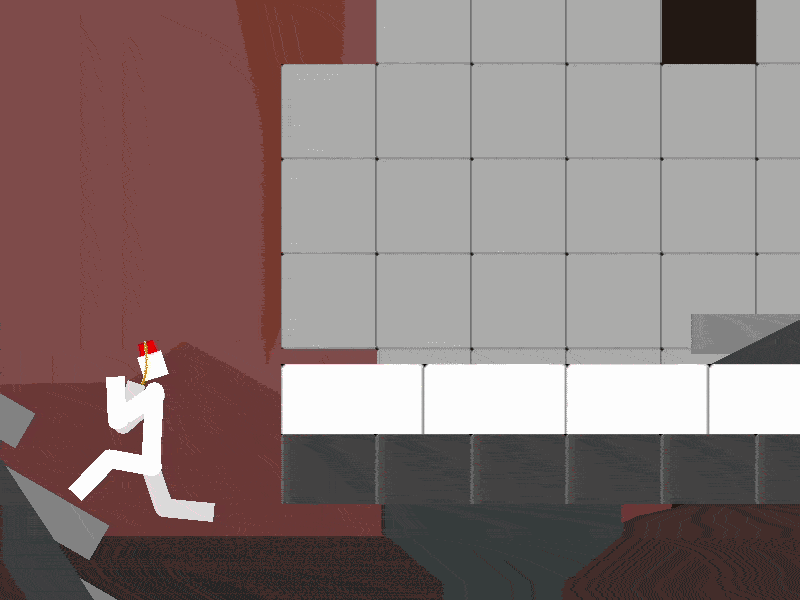
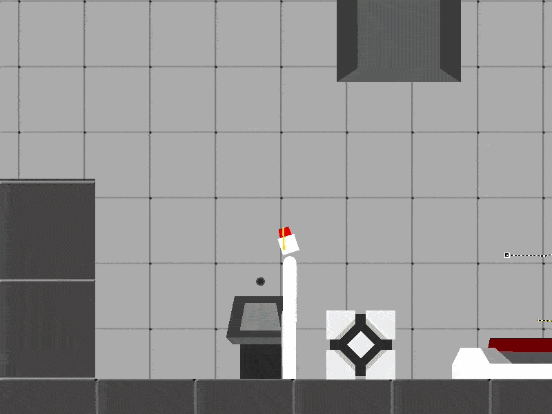

# Game Jam Submissions

These are all hosted on my Itch.io page.

## Bez

*Bezier Portal showing Mirroring*

The game was themed around masks. You can make masks on the game world which can be copied elsewhere.

*Puzzle and platforming solved by mask*

Portals are able to mirror both static and movable elements. This lets you solve puzzles through choosing where to put your cubes.
